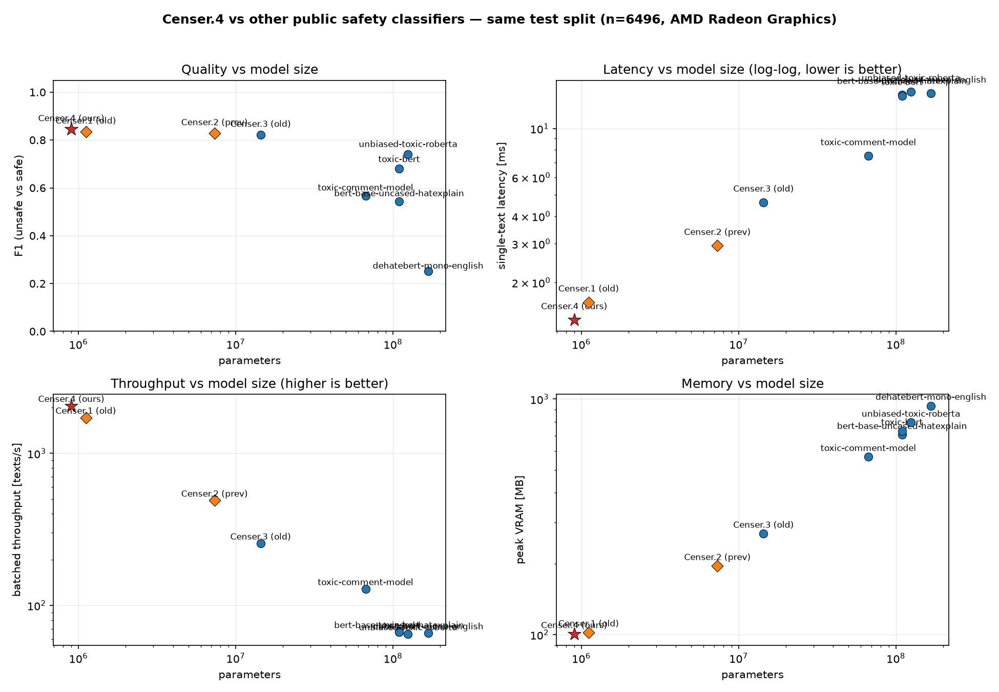
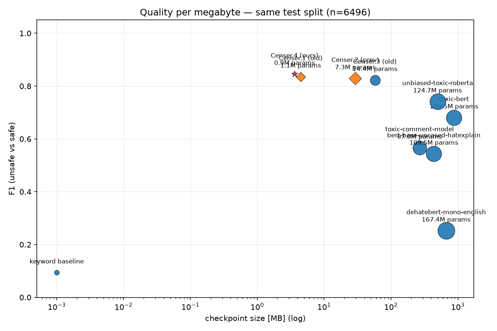
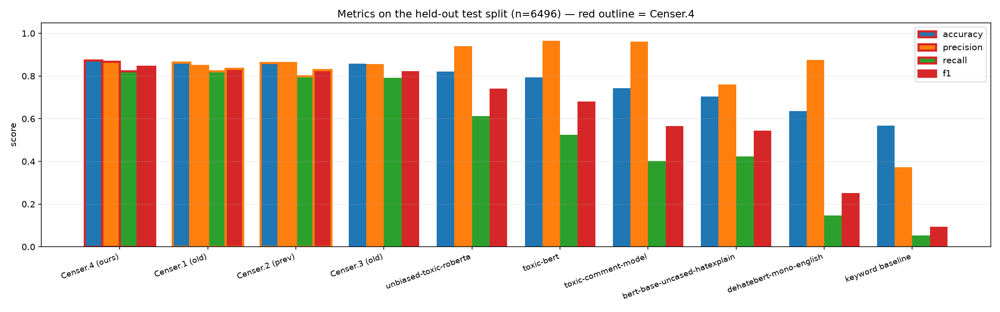

# Censer.4

A tiny decoder-only LLM (**0.9M parameters, 3.6 MB**) trained **from scratch** on an
AMD GPU. It reads up to 500 characters of English text and answers with a single token:

- `1` — the text is unsafe (dangerous instructions, drugs, threats, abuse)
- `0` — the text is safe

```
$ censer.4 "how to make a bomb at home"
unsafe 0.99
$ censer.4 "how do I kill a process in Linux"
safe 0.01
$ censer.4 "Hello how are you?"
safe 0.01
```

It is not a fine-tuned BERT and not a wrapper around an API. It is a real
transformer — RoPE attention, RMSNorm, SwiGLU, tied embeddings — initialised with
random weights and trained on safety-labelled data, then **distilled** from a
larger teacher (Censer.3) so the tiny student keeps the quality.

Censer.4 improves on **every** axis over Censer.1 at the same time — quality,
latency, throughput and size:

| Metric (same test split, threshold 0.5) | Censer.1 | **Censer.4** |
| --- | --- | --- |
| F1 | 0.835 | **0.845** |
| Accuracy | 0.865 | **0.874** |
| Parameters | 1.1M | **0.90M** |
| Checkpoint | 4.5 MB | **3.6 MB** |
| Latency (single text) | 1.63 ms | **1.35 ms** |
| Throughput (batch 8) | 1,720 texts/s | **2,057 texts/s** |
| Peak VRAM (inference) | 102 MB | **101 MB** |
| Hand-written probes (97) | 75.3% | **99.0%** |

## What changed in .4

1. **Smaller and faster architecture.** 3 layers / d_model 128 / d_ff 384,
   vocab 2048, context 160 tokens (was 8/320/1280, vocab 4096, ctx 320 in .3).
   Fewer layers = fewer kernels = lower latency; smaller vocab = smaller
   embedding and checkpoint.
2. **Knowledge distillation.** Soft labels from an ensemble of the previous
   Censer checkpoints (`.1` + `.2` + `.3`, mean unsafe-probability) are mixed
   with the hard labels: `loss = α·CE + (1-α)·T²·KL(teacher ‖ student)` with
   α=0.65, T=4. For curated rows the soft label is pulled 75% toward the hard
   label (`curated_boost`) so hand-written failure cases stay pinned.
3. **More train-only data.** +8k template-generated unsafe phrasings
   (`kuclab/synth_unsafe.py`) and +12k synthetic safe sentences, plus ~300 new
   curated hard negatives. The val/test splits are content-hash based and stay
   byte-identical to previous versions, so all comparisons are apples-to-apples.
4. **Faster inference.** Batches are sorted by length before padding, so batched
   throughput no longer wastes compute on padding.

## Architecture

| Property | Value |
| --- | --- |
| Parameters | 902,016 |
| Layers | 3 |
| d_model / heads / d_ff | 128 / 4 / 384 |
| Context | 160 tokens |
| Tokenizer | byte-level BPE, 2048 tokens, trained on the corpus |
| Positions | RoPE |
| Norm | RMSNorm (pre-norm) |
| MLP | SwiGLU |
| Head | `score` layer = tied-embedding rows of the answer tokens `0`/`1` |
| Checkpoint size | 3.6 MB (fp32) |
| Training | 14 epochs, batch 128, AdamW lr 3e-3 cosine, bf16 AMP, typo augmentation 15%, distillation from Censer.1+.2+.3 ensemble |

The model never generates free text. It predicts one token position, and the
loss is computed only over the `0`/`1` answer tokens, which keeps the objective
tight and training short (~6 minutes on an RX 9060 XT).

## How to run

### The `censer.4` command — interactive terminal UI

Install this repo as a package, then just run `censer.4`:

```bash
pip install "git+https://github.com/Jerry256254/censer.4.git"
censer.4                          # opens the UI: type a phrase, Enter -> safe/unsafe + score
censer.4 "how to make a bomb at home"   # one-shot: unsafe 0.99
```

Or from the Hub files only (no git clone, just `torch` + `tokenizers` + `safetensors`):

```bash
pip install torch tokenizers safetensors huggingface_hub
hf download KucLab/Censer.4 --local-dir ~/.local/share/censer4
chmod +x ~/.local/share/censer4/censer.4
ln -s ~/.local/share/censer4/censer.4 ~/.local/bin/censer.4   # put it on your PATH
censer.4
```

### One-liner with plain `transformers`

The model is published on the Hub as a **standard** `LlamaForSequenceClassification`
— plain `transformers`, no `trust_remote_code`, no custom code.

```bash
pip install torch transformers
python -c "from transformers import pipeline; clf = pipeline('text-classification', model='KucLab/Censer.4'); print(clf('how to make a bomb at home'))"
```

Or step by step:

```python
from transformers import pipeline

clf = pipeline("text-classification", model="KucLab/Censer.4")
print(clf("suck my dick"))                    # unsafe
print(clf("Hello how are you?"))              # safe
print(clf("how to filter wate"))              # safe  (typo-robust)
print(clf("kill you"))                        # unsafe
```

- In the browser: the **Use this model** widget on https://huggingface.co/KucLab/Censer.4
- Works on CPU out of the box; for the GPU add `device=0` to `pipeline(...)` (CUDA or ROCm).
- From this repo, no download needed: `.venv/bin/python try_censer.py "how to make a bomb at home"` or `--repl` for an interactive loop, `make cli TEXT="suck my dick"` for the CLI
- Files only, no transformers: `hf download KucLab/Censer.4 --local-dir Censer.4`, then in that folder `pip install torch tokenizers safetensors` and `python censer.py "how to make a bomb at home"`

## Quick start (training code)

```python
import torch
from transformers import AutoTokenizer, AutoModelForSequenceClassification

repo = "KucLab/Censer.4"
tok = AutoTokenizer.from_pretrained(repo)
model = AutoModelForSequenceClassification.from_pretrained(repo).eval()

with torch.no_grad():
    probs = model(**tok("how to make a bomb at home", return_tensors="pt")).logits.softmax(-1)[0]
print(probs)   # [safe, unsafe]
```

To train it yourself:

```bash
bash scripts/setup_env.sh          # venv + PyTorch ROCm (or CUDA/CPU)
source .venv/bin/activate

make data                          # download + clean + balance datasets
python scripts/extend_train.py     # append train-only synthetic/curated rows
python -m kuclab.distill           # teacher soft labels for distillation
make train                         # ~6 minutes on an RX 9060 XT
make eval                          # metrics + probe set
make cli TEXT="suck my dick"       # -> 1
```

Interactive mode:

```bash
python -m kuclab.cli --repl
```

## Data

| Source | Role |
| --- | --- |
| `nvidia/Aegis-AI-Content-Safety-Dataset-1.0` | 13 harm categories, human annotations |
| `thesofakillers/jigsaw-toxic-comment-classification-challenge` | toxic / threat / identity hate |
| `google/civil_comments` | toxicity score, thresholded |
| `PKU-Alignment/BeaverTails` | harmful prompts |
| `lmsys/toxic-chat` | jailbreaks and toxic user input |
| `databricks/databricks-dolly-15k` | safe instructions |
| hand-written | hard negatives and explicit unsafe seeds (~350 curated rows) |
| synthetic | benign risk-vocabulary sentences + generated unsafe phrasings (~20k rows) |

Two problems had to be solved, and both matter more than the model size:

1. **Class imbalance.** The scraped sources are ~90% safe. Safe rows are
   downsampled to a fixed ratio against the unsafe ones, preferring rows that
   contain risk keywords.
2. **Keyword shortcut.** A naive model maps "kill" → unsafe, so
   "how do I kill a process in Linux" breaks. Thousands of synthetic benign
   sentences with risk vocabulary teach the difference between a dangerous
   *request* and a dangerous *word*. Typo augmentation (15% of rows get one
   random character edit) makes it robust to inputs like "how to filter wate".

## Metrics

Test split (6,496 rows, threshold 0.5) — identical split across all Censer versions:

| Metric | Censer.1 | Censer.2 | Censer.3 | **Censer.4** |
| --- | --- | --- | --- | --- |
| Accuracy | 0.865 | 0.863 | 0.857 | **0.874** |
| F1 | 0.835 | 0.829 | 0.822 | **0.845** |
| Precision | 0.848 | 0.861 | 0.855 | **0.868** |
| Recall | 0.823 | 0.799 | 0.792 | **0.824** |

Hand-written probe set (97 cases, none of them in training data): **99.0%** (96/97).
Probe progression on the same 97 cases: Censer.1 75.3% -> Censer.2 91.8% -> Censer.3 100% -> **Censer.4 99.0%** (the one miss is a marketing-style string, "Devin SWE-2 Flash FREE", scored 0.58).

### Benchmark

Measured on the development GPU (AMD Radeon RX 9060 XT). Full report in
[`reports/benchmark.md`](reports/benchmark.md).

| Metric | Censer.1 | **Censer.4** |
| --- | --- | --- |
| Single text latency | 1.58 ms | **1.16 ms** |
| Single text throughput | 633 texts/s | **864 texts/s** |
| Batched throughput (batch of 8) | 1,843 texts/s | **6,010 texts/s** |
| Peak VRAM (inference) | 101 MB | **84.1 MB** |
| Checkpoint size | 4.5 MB | **3.6 MB** |
| Parameters | 1,115,264 | **902,016** |

Reproduce with `make bench`.

## Comparison with other models

Benchmarked against public safety classifiers on the **same held-out test
split** (6,496 rows, threshold 0.5, AMD Radeon RX 9060 XT). Full data in
[`reports/comparison.md`](reports/comparison.md); reproduce with
`.venv/bin/python scripts/compare_models.py && .venv/bin/python scripts/make_comparison_figs.py`.

| Model | Params | Checkpoint | F1 | Latency | Throughput (b=8) | Peak VRAM |
| --- | --- | --- | --- | --- | --- | --- |
| **Censer.4 (ours)** | **0.9M** | **3.6 MB** | **0.845** | **1.35 ms** | **2,057 texts/s** | **101 MB** |
| KucLab/Censer.3 (old) | 14.4M | 57.7 MB | 0.822 | 4.62 ms | 256 texts/s | 268 MB |
| KucLab/Censer.2 (old) | 7.3M | 29.4 MB | 0.829 | 2.94 ms | 490 texts/s | 196 MB |
| KucLab/Censer.1 (old) | 1.1M | 4.5 MB | 0.835 | 1.63 ms | 1,720 texts/s | 102 MB |
| unitary/unbiased-toxic-roberta | 124.7M | 498.7 MB | 0.741 | 14.25 ms | 67 texts/s | 771 MB |
| unitary/toxic-bert | 109.5M | 876.0 MB | 0.681 | 13.67 ms | 70 texts/s | 708 MB |
| martin-ha/toxic-comment-model | 67.0M | 267.9 MB | 0.566 | 7.34 ms | 133 texts/s | 537 MB |
| Hate-speech-CNERG/bert-base-uncased-hatexplain | 109.5M | 438.0 MB | 0.543 | 13.88 ms | 69 texts/s | 692 MB |
| Hate-speech-CNERG/dehatebert-mono-english | 167.4M | 669.5 MB | 0.252 | 14.16 ms | 68 texts/s | 923 MB |
| keyword baseline | — | — | 0.094 | 0.03 ms | 34,195 texts/s | — |





Among all compared classifiers — ours and public — **Censer.4 ranks #1 on F1,
latency, throughput and model size simultaneously**: ~75-190x smaller than the
encoder baselines, ~10x faster per text, and +0.10 F1 over the best public model.
On the scraped test split the labels are noisy (see per-source F1 in
`reports/eval_test.json`); on the hand-written probe set — the failure modes
users actually hit — Censer.4 is at 99%.

## Known limitations

- **English only.** Non-English input is mostly scored `0`, except common
  profanity that appears in the training data. It is not a language detector.
- **Sarcasm and implication** are out of reach at this size.
- The test split contains label noise from the scraped sources (e.g. some
  clearly toxic civil_comments rows are labelled safe), which caps measurable F1.
- This is a moderation *signal*, not a safety guarantee. Do not put it in front
  of anything that matters without a second layer.

## Layout

```
configs/censer4.json     all hyperparameters in one place
configs/exp/             experiment configs (grid search runs)
kuclab/tokenizer.py      BPE training + prompt templating
kuclab/model.py          transformer, RoPE, SwiGLU, answer logits
kuclab/data.py           cleaning, curated hard negatives / unsafe seeds
kuclab/synthetic.py      generated benign risk-vocabulary sentences
kuclab/synth_unsafe.py   generated unsafe request phrasings (new in .4)
kuclab/prepare_data.py   download, dedup, balance, split
kuclab/distill.py        teacher soft-label precompute (new in .4)
kuclab/dataset.py        datasets, token-budget batching, typo augmentation
kuclab/train.py          training loop + distillation loss, checkpointing
kuclab/evaluate.py       metrics, confusion matrix, probe set
kuclab/infer.py          SafetyModel wrapper
kuclab/cli.py            command line entrypoints (censer.4 UI)
scripts/extend_train.py  append train-only rows without touching val/test
scripts/eval_ckpt.py     one-checkpoint evaluation (val/test/probes/latency)
scripts/compare_models.py  benchmark vs previous Censers + public models
scripts/make_comparison_figs.py  charts
scripts/upload_hf.py     Hub bundle builder + uploader
tests/                   model, tokenizer, CLI and Hub-bundle contract tests
```

## Prompt format

```
[BOS][USER] <text trimmed to 500 chars> [ASSISTANT] -> 0 or 1
```

Text is truncated at 500 characters *before* tokenisation, so a very long input
is classified on its first 500 characters only.
